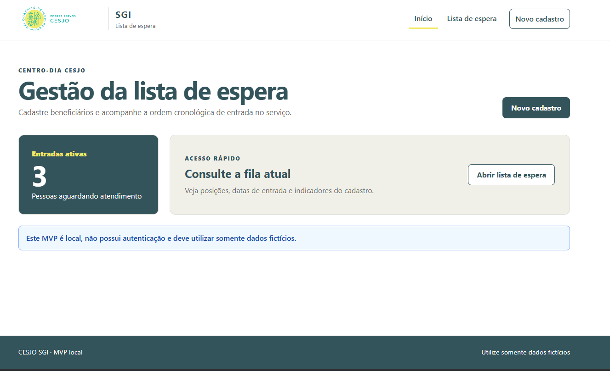
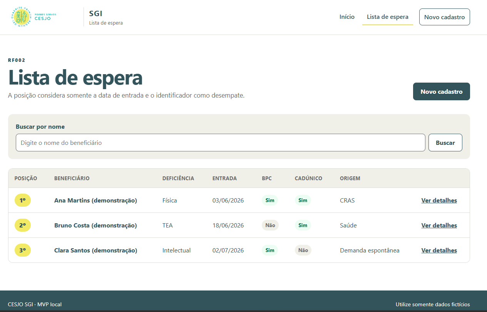
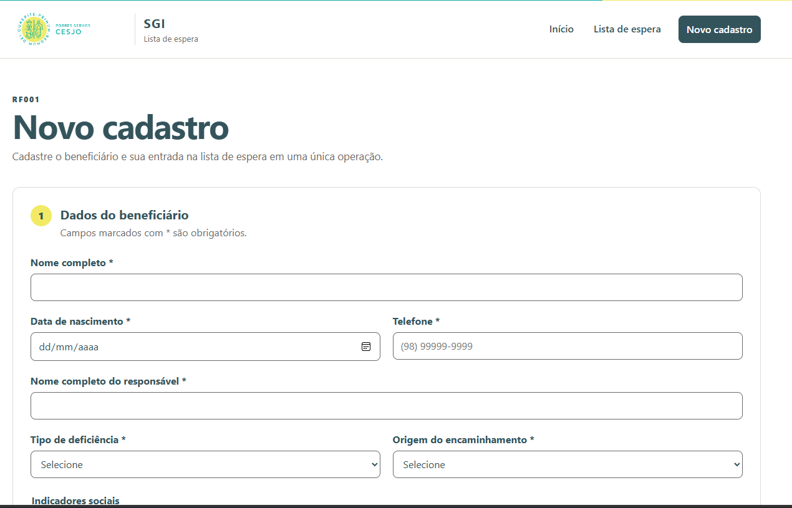

# CESJO SGI - MVP

<p align="center">
  
</p>

## Objetivo do sistema completo

Sistema de gestão de informações para o Centro-Dia, destinado ao atendimento de pessoas com deficiência física, sensorial, intelectual, múltipla, TEA ou T21, na faixa etária de 18 a 59 anos. O sistema deverá registrar informações de BPC e CadÚnico, enquanto a regra de prioridade ainda será validada com a equipe do CESJO.

O MVP atual implementa somente o cadastro de beneficiários e o acompanhamento cronológico da lista de espera.

## O que está implementado

- painel com quantidade de entradas ativas;
- cadastro transacional de beneficiário e entrada na fila;
- upload local de laudo e comprovante em PDF, JPEG ou PNG, até 5 MB;
- lista cronológica com busca por nome;
- posição calculada, sem persistência redundante;
- detalhes do beneficiário e metadados dos documentos;
- três registros fictícios carregados na primeira execução;
- SQLite persistente com chaves estrangeiras ativas.

## Capturas de tela

### Página inicial



### Lista de espera



### Novo cadastro



## Limites importantes

Este MVP é destinado somente a desenvolvimento local e demonstração. Ele não possui autenticação, autorização por perfil, auditoria completa, backup ou política definitiva de armazenamento de documentos.

**Não publique esta versão e não utilize dados pessoais reais.**

BPC e CadÚnico são registrados, mas não alteram a posição automaticamente, pois a regra de prioridade ainda depende de validação do negócio.

## Requisitos locais

- JDK 21 instalado (o JRE sozinho não é suficiente);
- variável de ambiente `JAVA_HOME` apontando para o diretório do JDK;
- Node.js 20.19+ ou 22.12+ instalado;
- npm, normalmente instalado junto com o Node.js;
- acesso à internet na primeira execução do Maven Wrapper e na instalação das dependências npm.

O Maven Wrapper já está incluído no repositório, portanto não é necessário instalar o Maven globalmente.

Este projeto não depende de Java ou Node armazenados dentro do repositório. Cada ambiente de desenvolvimento deve possuir esses pré-requisitos instalados.

## Executar o backend

Partindo da raiz do projeto:

```powershell
cd backend
.\mvnw.cmd spring-boot:run
```

Mantenha esse terminal aberto enquanto estiver utilizando o sistema.

O backend utiliza `../data/cesjo-mvp.db` e atende em `http://localhost:8080`.

Variáveis opcionais:

```powershell
$env:SQLITE_DB_PATH='C:\caminho\cesjo-mvp.db'
$env:UPLOAD_DIR='C:\caminho\uploads'
```

## Executar o frontend

Em outro terminal:

```powershell
cd frontend
npm.cmd install
npm.cmd run dev
```

Mantenha também esse terminal aberto e acesse `http://localhost:5173`. A porta `8080` atende somente à API e não possui a interface visual do sistema.

## Validar

Backend:

```powershell
cd backend
.\mvnw.cmd test
```

Frontend:

```powershell
cd frontend
npm.cmd run typecheck
npm.cmd run build
```

## Fluxo manual rápido

1. Abra a página inicial e confirme três entradas ativas.
2. Acesse **Lista de espera** e verifique a ordem das datas.
3. Pesquise por `Ana`.
4. Abra os detalhes e confira posição, indicadores e documentos.
5. Clique em **Novo cadastro**, utilize somente dados fictícios e envie dois arquivos permitidos.
6. Confirme a mensagem de sucesso e a nova posição.
7. Reinicie o backend e verifique que o cadastro permanece no SQLite.

## Documentação

- Requisitos e modelos: `docs/requisitos/`.
- Guia visual e referências: `docs/frontend/`.
- Prompts de condução: `docs/prompts/`.

## Implementações futuras

As próximas etapas devem ser priorizadas somente depois da validação deste MVP com a equipe do CESJO:

1. validar a regra de prioridade entre cronologia, BPC e CadÚnico;
2. implementar autenticação e autorização por perfil;
3. implementar gestão e notificação de vagas, admissão e histórico de entradas;
4. adicionar visitas domiciliares, escutas, PIA e acompanhamento dos beneficiários;
5. implementar desligamentos, violações de direitos, atividades e comunicações;
6. criar auditoria completa, política definitiva de documentos, backup e recuperação;
7. adicionar relatórios administrativos e indicadores validados pelo negócio;
8. implementar notificações por canais aprovados pela instituição;
9. migrar de SQLite para PostgreSQL antes de uma implantação pública ou multiusuário;
10. preparar infraestrutura de produção, monitoramento, testes de segurança e revisão completa de acessibilidade.

Esses itens não fazem parte da entrega atual e não devem ser desenvolvidos antes da confirmação das regras de negócio correspondentes.
