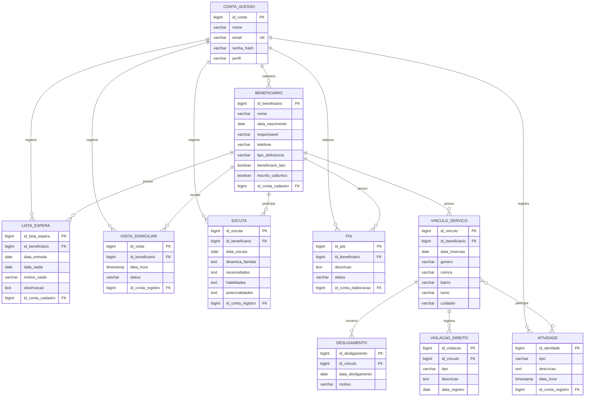

# Diagrama Entidade-Relacionamento

## Situação do documento

Este arquivo é a versão editável e versionável do diagrama do projeto.

O diagrama abaixo representa o núcleo priorizado do sistema e corrige a ambiguidade do termo `Usuario`:

- `ContaAcesso` representa o profissional que entra no sistema.
- `Beneficiario` representa a pessoa candidata ou atendida pelo Centro-Dia.
- `ListaEspera` representa cada passagem do beneficiário pela fila.
- `VinculoServico` representa a admissão do beneficiário no serviço.

## DER consolidado do núcleo

## Regras estruturais

1. Um beneficiário é cadastrado uma única vez e pode passar pela lista de espera mais de uma vez.
2. Um beneficiário não pode possuir duas entradas ativas simultâneas na lista.
3. A admissão no serviço não cria uma cópia do beneficiário; cria um `VinculoServico`.
4. A faixa etária é calculada a partir da data de nascimento e não deve ser armazenada de forma redundante.
5. Senhas pertencem somente a `ContaAcesso` e devem ser armazenadas como hash.
6. Relatórios e dashboards são projeções dos dados transacionais e não geram entidades próprias neste momento.

## Partes ainda pendentes de detalhamento

O documento de requisitos ainda não fornece informação suficiente para fechar:

- cardinalidade e segmentação de vagas;
- profissionais participantes de uma visita ou atividade;
- versionamento e aprovações do PIA;
- participantes de atividades coletivas;
- estrutura de contatos, ofícios e encaminhamentos;
- detalhes de parcerias, colaboradores e doações;
- estrutura de auditoria exigida pelo requisito não funcional.

Essas partes devem ser acrescentadas ao DER quando seus critérios de aceite forem definidos.
