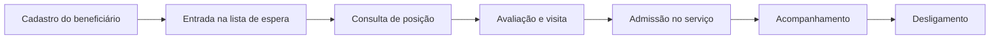

# SGI - Sistema de Gestão de Informações

## Visão geral

Sistema web para a gestão administrativa e o acompanhamento de pessoas com deficiência atendidas pelo Centro Educacional e Social São José Operário (CESJO).

O sistema deve apoiar:

- lista de espera;
- avaliação e atendimento;
- Plano de Atendimento Individual e Familiar;
- vínculo e desligamento do serviço;
- registro de violações de direitos;
- atividades, contatos e comunicações;
- gestão institucional;
- relatórios e dashboards.

## Estado do projeto

O projeto encontra-se na fase de documentação e definição da baseline. Ainda não há backend, frontend, banco implantado ou funcionalidades concluídas neste repositório.

O núcleo documental da lista de espera foi reconciliado, mas existem decisões de negócio pendentes. Consulte a [matriz de rastreabilidade](matrizRastreabilidade.md).

## Prioridade de implementação

A primeira funcionalidade priorizada é a lista de espera.

Fluxo conceitual inicial:

A implementação deve ocorrer por microetapas e somente até o limite permitido pelos documentos validados.

## Terminologia

- **Conta de acesso:** profissional que entra no sistema.
- **Beneficiário:** pessoa candidata ou atendida.
- **Entrada na lista de espera:** participação histórica do beneficiário na fila.
- **Vínculo com o serviço:** período após a admissão no Centro-Dia.

O nome genérico `Usuario` não deve ser adotado para entidades de domínio.

## Stack definida

### Backend

- Java 21.
- Spring Boot 3.5.
- Spring Web.
- Spring Data JPA.
- Bean Validation.
- Maven.

### Banco de dados

- PostgreSQL.
- Migrations versionadas.
- Hibernate sem criação ou atualização automática do schema.

### Frontend

- React.
- Vite.
- JavaScript ou TypeScript a decidir no bootstrap.
- Interface administrativa responsiva.

### Arquitetura

- Monólito simples.
- API REST.
- Sem infraestrutura distribuída antecipada.

## Perfis de acesso

- Coordenador.
- Equipe técnica.
- Administrativo.
- Consulta.

As permissões gerais estão nos [requisitos](requisitos.md). A matriz detalhada por operação ainda deve ser criada.

## Documentação

Comece pelos [requisitos](requisitos.md), pelas [decisões do projeto](decisoesProjeto.md) e pela [matriz de rastreabilidade](matrizRastreabilidade.md).

Para a implementação inicial local com SQLite, utilize o [Prompt Base do MVP](promptMVP.md). Essa decisão é temporária e não substitui PostgreSQL como banco de uma implantação futura.

## Próximas microetapas sugeridas

1. Validar a prioridade, o desempate e o ciclo da lista de espera.
2. Validar a política de armazenamento de laudo e comprovante.
3. Criar a estrutura inicial do backend.
4. Criar a migration do núcleo.
5. Implementar o cadastro do beneficiário.
6. Implementar a entrada na lista.
7. Implementar a consulta cronológica da fila.

Cada item deve ser autorizado e validado separadamente, conforme o [Prompt Base do MVP](promptMVP.md).
